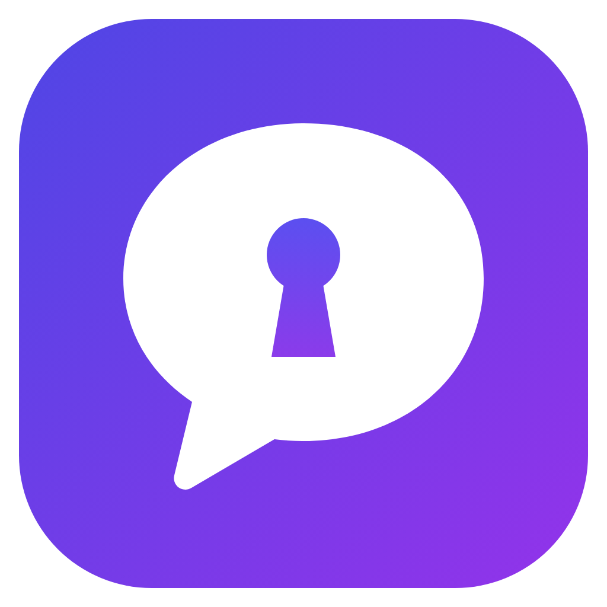

<p align="center"></p>

<h1 align="center">Mnemo</h1>
<p align="center"><b>Every chat in sight, locked safe and tight.</b></p>

Mnemo puts **WhatsApp, Messenger, Instagram, Threads, Telegram, Zalo, Discord, Slack, WeChat and LinkedIn** in one Windows 11 window, keeps an **encrypted local archive** of your messages and files (like POP3 for chats), and adds an **AI writing and summary assistant** that uses your own AI accounts.

> Mnemo gom WhatsApp, Messenger, Instagram, Threads, Telegram, Zalo, Discord, Slack, WeChat và LinkedIn vào một cửa sổ, lưu bản sao tin nhắn và tệp **trên máy bạn, có mã hóa**, và có trợ lý AI giúp viết, tóm tắt, gợi ý trả lời bằng chính tài khoản AI của bạn.

## Tính năng

**Một cửa sổ cho 10 ứng dụng**
- Mỗi tài khoản chạy bản web chính chủ (WhatsApp Web, `facebook.com/messages`, Instagram Direct, Telegram Web A, Zalo Web, Discord, WeChat Web, Threads (tin nhắn trên web), Slack, LinkedIn Messaging) trong một hồ sơ trình duyệt riêng, nên **thêm được nhiều tài khoản cho cùng một ứng dụng**.
- Số tin chưa đọc trên thanh bên; gọi điện, mic, camera và thông báo được cấp quyền sẵn.
- Giao diện **song ngữ Việt/Anh** (Cài đặt → Giao diện → Ngôn ngữ); câu trả lời của AI theo ngôn ngữ đã chọn.
- Thẻ "Thêm tài khoản" và huy hiệu nhỏ trên avatar dùng **biểu tượng của chính từng dịch vụ**. Mnemo không đóng gói logo của bên thứ ba: khi chạy, nó tải favicon công khai của trang (qua dịch vụ favicon của Google, dự phòng là `favicon.ico` của chính trang) và lưu tạm trong thư mục cấu hình. Khi chưa tải được thì hiện chữ viết tắt.
- Messenger, Instagram và LinkedIn bị khóa trong phần tin nhắn: bấm vào trang cá nhân hay bài đăng thì mở trong trình duyệt. Mọi liên kết ra ngoài cũng mở trong trình duyệt.

**Thanh bên, thông báo, khay hệ thống**
- Thanh Mnemo mặc định **nằm trên cùng**, mở rộng đầy đủ; đặt được **trái, phải, trên cùng hoặc dưới cùng** (Cài đặt → Giao diện). Đặt bên phải thì thanh điều hướng riêng của WhatsApp, Discord… nằm sát mép trái cửa sổ; trên/dưới thì thanh nằm ngang như các tab.
- **Kéo thả** tài khoản trên thanh bên để đổi thứ tự. Nút **+** mở bảng chọn 10 ứng dụng ngay cạnh nút, đè lên trang đang mở. Bấm logo để về trang chủ.
- **Dùng chung đăng nhập Meta:** khi thêm Instagram có thể dùng luôn tài khoản Messenger (Instagram hiện "Tiếp tục với tư cách…"), khi thêm Threads có thể dùng luôn tài khoản Instagram; các tài khoản này chạy chung dữ liệu trình duyệt.
- **Tạm tắt tài khoản:** tài khoản tạm tắt không chạy, không tốn RAM, không nhận tin hay thông báo và không hiện trên thanh Mnemo; ở trang chủ nó hiện màu xám với nút **Kích hoạt lại**. Đăng nhập vẫn được giữ nên bật lại là dùng ngay.
- Mỗi tài khoản hiện **avatar của bạn trong app** (tự lấy từ trang nếu được, hoặc ảnh bạn chọn), có icon nhỏ của app ở góc dưới phải. Bên cạnh là tên app ở trên, tên tài khoản ở dưới, và số tin chưa đọc. Thanh bên thu gọn được, chỉ còn avatar.
- **Thông báo tin mới của Mnemo** ở góc phải dưới màn hình, gồm: dòng đầu "Tên app - tên tài khoản" (màu vàng) và giờ, dòng hai tên người gửi in đậm, dòng ba nội dung.
  - Khi app không gửi thông báo riêng mà chỉ tăng số chưa đọc, Mnemo hiện thông báo chung; nếu nhiều người cùng nhắn, dòng From ghi số người và tên (vd "3 người: An, Bình, Chi"), lấy từ các hội thoại đang có dấu chưa đọc trong danh sách chat.
  - Mnemo nhận chính các thông báo mà app định hiện, nên có cả tin ở hội thoại chưa mở. Thông báo gốc của trang bị tắt để không trùng.
  - **Bấm vào thông báo** thì mở Mnemo đúng tài khoản và chạy lại hành động bấm thông báo của chính app, để tới đúng hội thoại và tin nhắn.
  - Bật/tắt riêng từng tài khoản. Có tùy chọn ẩn nội dung và chỉnh thời gian hiển thị.
- Số chưa đọc của Telegram và WhatsApp là **tổng số tin chưa đọc** đọc từ huy hiệu trong danh sách chat (bỏ qua hội thoại đã tắt tiếng), chỉ tính các hội thoại danh sách đang hiển thị. Các app khác lấy số từ tiêu đề trang.
- Đăng nhập, xác minh và cấp quyền của Meta (Instagram, Threads, Messenger, "Tiếp tục bằng Instagram/Facebook") đều mở ngay trong Mnemo.
- **Số tin chưa đọc tổng** trên biểu tượng taskbar (có thể tắt), trên tiêu đề cửa sổ và trên tooltip ở khay.
- Chuyển qua lại giữa các tài khoản **không tải lại trang**: tài khoản không hiển thị vẫn chạy (được "đỗ" ngoài khung cửa sổ thay vì bị ẩn), nên WhatsApp và các app khác giữ nguyên phiên và kết nối.
- **Khởi động cùng Windows**, chọn được: thu nhỏ trên taskbar (hiện icon và số chưa đọc) hoặc chỉ ở khay hệ thống. Chi tiết: Mnemo chạy ẩn ở khay hệ thống, vẫn lưu tin và vẫn hiện thông báo. **Bấm × thì thu về khay**; thoát hẳn từ menu khay hoặc nút "Thoát Mnemo ngay" trong Cài đặt. Hai tùy chọn này có cả trong **Cài đặt → Khởi động & khay hệ thống** lẫn menu chuột phải ở biểu tượng khay.

**Kho tin nhắn cục bộ**
- **Mức A, tự động:** tin nhắn và tệp mà ứng dụng hiển thị được lưu ngay khi bạn mở hội thoại.
- **Mức B, nhập tệp xuất chính thức:**
  - Telegram Desktop (JSON)
  - WhatsApp "Xuất đoạn chat" (.zip/.txt, cả định dạng Android lẫn iPhone)
  - Meta "Tải thông tin của bạn" cho Messenger/Instagram (JSON), có tự sửa lỗi phông tiếng Việt
- Nhập lại nhiều lần **không bị trùng**.
- Kho là **một tệp SQLCipher** (`mnemo.db`) trong thư mục bạn chọn. Khóa giải mã được giữ bằng Windows DPAPI, có **khóa khôi phục** để mở kho trên máy khác.
- **Tìm kiếm toàn văn không cần dấu**: gõ "bun" ra "bún". Có xem lại hội thoại và lịch sử sửa tin.
- **Quy tắc tự động lưu tệp:**
  - chọn loại tệp (ảnh, video, âm thanh, tài liệu, khác)
  - danh sách đuôi tệp luôn cho phép và luôn chặn (mặc định chặn tệp chạy được như .exe)
  - dung lượng tối đa, có lưu trong nhóm hay không, hội thoại loại trừ, tự xóa sau N ngày
  - đặt chung hoặc riêng cho từng tài khoản
- **Chọn nơi lưu** cho cả kho tin nhắn lẫn thư mục tệp tải về. Có thể bật mã hóa cả tệp đã lưu.

**Trợ lý AI**
- **Mọi tính năng AI nằm trong một panel bên phải** (nút ✦ trên thanh Mnemo), chọn tính năng bằng tab: **Hội thoại** (tóm tắt, gợi ý trả lời, hỏi đáp) và **Trợ lý viết**.
- Trong ô soạn tin có **nút kiểm tra tròn ở góc dưới phải**: khi đang quét viền xoay; xong thì hiện số gợi ý. Bấm vào để mở tab Trợ lý viết.
- Nút **Tải lại** trên thanh Mnemo mở lại trang của tài khoản đang xem (dùng được cả khi trang bị treo).
- **Trợ lý viết** chỉ đọc **nội dung trong ô soạn tin** của tài khoản đang mở, không bao giờ đọc hay gửi cuộc trò chuyện. Mở panel thì bản nháp được kiểm tra ngay (hoặc nhấn **Ctrl+Shift+Space** trong ô soạn tin):
  - điểm 0–100, gợi ý theo 4 nhóm **Đúng** (đỏ), **Rõ ràng** (xanh dương), **Hấp dẫn** (xanh lá), **Giọng điệu** (tím), nhận xét giọng điệu, bật/tắt "Kiểm tra khi gõ";
  - tab **Gợi ý** (bấm một gợi ý thì chữ đó được tô sáng trong ô soạn tin), **Mục tiêu** (mức trang trọng, người nhận, mục đích, ngôn ngữ, từ điển riêng), **Viết** (trang trọng hơn, thân thiện hơn, ngắn gọn, mở rộng, đơn giản, hay hơn, skills, hoặc bảo AI viết; xong thì thay vào ô soạn tin);
  - lỗi được **gạch chân 4 màu** trong ô soạn tin; rê chuột vào để mở thẻ gợi ý: **bấm chữ màu xanh** để nhận, hoặc **Bỏ qua** / **Thêm vào từ điển**.
- **Panel AI cho từng ứng dụng:**
  - Với từng hội thoại: **tóm tắt tin chưa xem**, **tóm tắt theo khoảng thời gian**, và **gợi ý câu trả lời** dựa trên tin chưa xem; bấm vào gợi ý thì nó được chèn vào ô soạn, bạn tự bấm gửi.
  - **Hỏi đáp trên nhiều hội thoại** cùng lúc.
- **Providers:**
  - **Claude Code**: dùng tài khoản Claude bạn đã đăng nhập CLI
  - **ChatGPT qua Codex CLI**: tài khoản ChatGPT
  - **OpenAI API**, **Gemini (Google AI Studio)**, **Grok (xAI)**, **Anthropic API**
  - mọi **API tương thích OpenAI** khác: DeepSeek, MiniMax, OpenRouter, llama.cpp chạy trên máy…
  - API key được lưu mã hóa bằng DPAPI.

## Tiết kiệm RAM

Mỗi tài khoản là một trình duyệt WebView2. Mnemo giảm RAM bằng ba cách (Cài đặt → Bộ nhớ):
- **Tự động:** tài khoản không hiển thị, và mọi tài khoản khi Mnemo thu về khay hoặc thu nhỏ, được hạ mức dùng bộ nhớ (WebView2 MemoryUsageTargetLevel = Low); trang vẫn chạy, vẫn nhận tin.
- Không dùng TrySuspend (đóng băng trang) vì trang bị đóng băng không nhận tin hay thông báo; muốn tài khoản không tốn gì thì dùng **Tạm tắt**.
- **Tăng tốc phần cứng (GPU) luôn bật**: cuộn mượt và đỡ tốn pin hơn vẽ bằng CPU. Giao diện của Mnemo (thanh Mnemo, thông báo) chạy chung trình duyệt với nhóm tài khoản đông nhất, không mở trình duyệt riêng.
- **Dùng chung tiến trình trình duyệt** (mặc định bật, tắt được bằng công tắc): các tài khoản của các ứng dụng khác nhau chạy chung một bộ trình duyệt (một tiến trình GPU, mạng, lưu trữ… thay vì mỗi tài khoản một bộ). Khi bật lần đầu, tài khoản xếp trước của mỗi nhóm giữ đăng nhập, các tài khoản còn lại đăng nhập lại một lần. Tài khoản mới sau đó tự vào nhóm. Tắt công tắc thì mỗi tài khoản nhận lại một bản sao riêng của bộ chung, nên vẫn giữ đăng nhập.

## Cài đặt

Tải `Mnemo-<version>-windows-x64.zip` từ mục Actions/Releases rồi giải nén. Trong đó có:
- `Mnemo.exe`: bản chạy trực tiếp (cần WebView2 Runtime, Windows 11 đã có sẵn)
- `Mnemo_<version>_x64-setup.exe`: bộ cài

## Cách dùng nhanh

1. Thêm tài khoản và đăng nhập như trên trình duyệt (QR cho WhatsApp, Zalo, Telegram).
2. Mở hội thoại: tin nhắn được lưu vào kho. Xem trong **Kho tin nhắn** (biểu tượng hộp).
3. Muốn có lịch sử cũ: vào **Nhập từ tệp xuất**, làm theo hướng dẫn của từng ứng dụng.
4. AI: vào **Cài đặt → AI**, bật provider bạn dùng. Với Claude Code hoặc Codex chỉ cần đã đăng nhập CLI. Với các provider khác, dán API key rồi bấm "Tải danh sách model".

## Giới hạn cần biết

- **Mức A chỉ thấy những gì ứng dụng hiển thị.** Hội thoại chưa mở, hoặc tin cũ chưa cuộn tới, sẽ không có trong kho. Hãy dùng mức B để lấp lịch sử cũ.
- Facebook, Instagram, Zalo, Discord và WeChat hay đổi cấu trúc trang. Nếu một ứng dụng không còn được lưu, hãy chỉnh selector:
  1. Mở **Cài đặt → Nâng cao → Cấu hình dịch vụ**.
  2. Chép `<dịch vụ>.default.json` thành `<dịch vụ>.json` rồi sửa.
  3. Tải lại tài khoản.

  Dùng **DevTools** trong trang tài khoản để dò phần tử. Selector của Telegram và WhatsApp ổn định nhất; selector cho Messenger, Instagram và Zalo dựa trên vai trò/thuộc tính của trang và **chưa được kiểm tra trên tài khoản thật**.
- **Thời gian tin nhắn:** WhatsApp cho thời gian chính xác đến phút. Telegram, Messenger, Instagram và Zalo chỉ hiển thị giờ, nên kho ghi giờ hiển thị kèm thời điểm lưu (đánh dấu ≈). Tin nhập từ tệp xuất luôn có thời gian chính xác.
- **"Chưa xem"** là các tin đến nằm sau vạch "tin chưa đọc" của ứng dụng (Telegram), hoặc sau lần cuối bạn trả lời hay bấm "Đánh dấu đã xem".
- Zalo, Discord, WeChat, Threads, Slack và LinkedIn chưa có bản xuất chính thức đọc được, nên chỉ có mức A.
- **WeChat Web** bị Tencent chặn đăng nhập với nhiều tài khoản (nhất là tài khoản mới hoặc đăng ký ngoài một số khu vực). Nếu trang báo không thể đăng nhập bằng web, Mnemo không thể vượt qua giới hạn đó.
- Discord: Mnemo chỉ chạy bản web chính chủ bằng tài khoản người dùng bình thường, không tự động hóa gì; selector cho Discord, WeChat, Threads, Slack và LinkedIn **chưa được kiểm tra trên tài khoản thật**.
- **Xác minh bằng Google/Apple/Microsoft:** khi Facebook, Instagram hay ứng dụng khác bắt xác minh danh tính bằng tài khoản Google, trang đăng nhập mở ngay trong Mnemo (cùng hồ sơ của tài khoản đó) và trả kết quả về ứng dụng. Google đôi khi từ chối đăng nhập trong ứng dụng nhúng; khi đó hãy thử lại sau hoặc xác minh trên điện thoại.
- Avatar tự động lấy được trên WhatsApp và Messenger (nếu trang hiển thị). Telegram Web chỉ hiện avatar của bạn trong màn Cài đặt (☰ → Settings): mở màn đó một lần là Mnemo lấy và giữ ảnh. Khi selector không khớp, hãy chọn ảnh trong trang tài khoản.
- Thông báo dựa vào việc app gửi thông báo web. Nếu một app không gửi, Mnemo vẫn hiện thông báo chung "N tin nhắn mới" khi số chưa đọc tăng.
- Viber không có bản web nên không được hỗ trợ.

## Bảo mật và quyền riêng tư

- Mnemo **không có máy chủ**. Tin nhắn chỉ rời máy bạn khi bạn chủ động dùng AI, và khi đó chỉ gửi tới provider bạn chọn. Muốn hoàn toàn cục bộ thì dùng llama.cpp hoặc một API cục bộ.
- Trang của các ứng dụng chỉ được gọi các lệnh lưu tin và mở trợ lý viết (`capabilities/services.json`). Chúng không đọc được cài đặt, khóa hay tệp. Tài khoản luôn được xác định theo webview gọi lệnh, không theo dữ liệu trang gửi lên.
- Tệp đính kèm chỉ được tải từ CDN của chính dịch vụ, có giới hạn dung lượng. Tên tệp được làm sạch trước khi ghi xuống đĩa.
- Nội dung tin nhắn gửi cho AI được đánh dấu là dữ liệu, không phải lệnh, để giảm rủi ro prompt injection từ tin nhắn của người khác.
- Tin bị người gửi thu hồi mặc định bị xóa khỏi kho, vì đó là quyền riêng tư của họ. Bạn có thể đổi trong Cài đặt.
- Sử dụng các ứng dụng qua Mnemo vẫn phải tuân theo điều khoản của từng dịch vụ.

## Build từ mã nguồn

Yêu cầu: Rust (stable), Node.js 18+, Windows 10/11 với WebView2.

```powershell
cd src-tauri
cargo test
npx @tauri-apps/cli@2 build
```

GitHub Actions (`.github/workflows/build.yml`) build trên `windows-latest` và xuất hai tệp: `Mnemo-<version>-windows-x64.zip` và `Mnemo-<version>-source.zip`.

Cấu trúc:
- `src-tauri/src`: backend Rust
  - `archive.rs`: kho SQLCipher và FTS5
  - `capture.rs`: lệnh cho trang ứng dụng
  - `importers/`: mức B
  - `ai/`: providers và prompt
  - `webviews.rs`: cửa sổ và webview
- `src-tauri/inject`: script chạy trong trang ứng dụng và selector của từng dịch vụ
- `ui`: giao diện chính và popup trợ lý viết

## Giấy phép


Dual-licensed under [MIT](LICENSE-MIT) or [Apache-2.0](LICENSE-APACHE), at your option.
